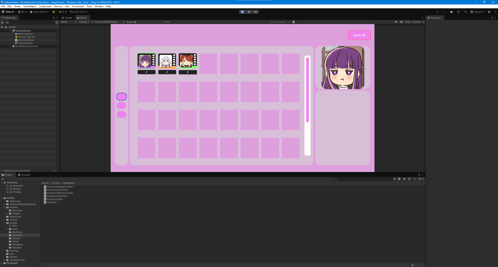
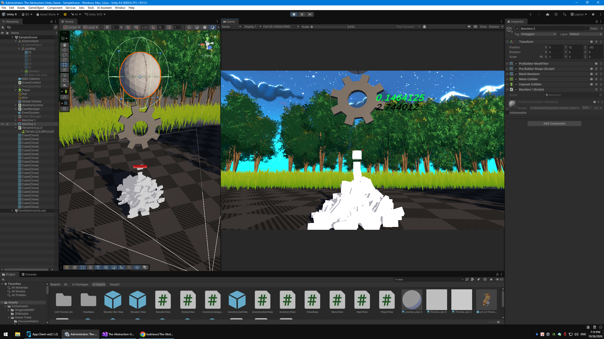

# The Abstraction — Unity Game

# Bùi Triều Vĩ
# Zalo và điện thoại: 0931512910
# Gmail: buitrieuvi2019@gmail.com

# Xem Video và hình ảnh của sản phẩm tại link Drive
- https://drive.google.com/drive/folders/1GEylE2CiYRXm7m9bP85lcC3NmrnQsI0n?usp=sharing
- Game đang trong quá trình phát triển trên Steam và Itch.io

Nội dung bao gồm:
- Công nghệ Unity, C# và Visual Studio.
- Zenject, R3, DOTween, Input System, TextMeshPro và ProBuilder.
- Chức năng nhân vật 3D, Inventory, Elevator, Machine, Money và UI.
- Kiến trúc State Machine, MVVM và Dependency Injection.

# Giai đoạn phát triển game 1
- Machine 1 : tạo ra các cube có giá trị khác nhau
- Machine 2 : hấp thụ các cube để tạo ra tiền
- tiền : dùng để nâng cấp và tra đổi với game và người chơi khác

# Hình ảnh Demo

.png)
.png)
.png)
.png)

## Công nghệ và Package sử dụng

Dự án sử dụng Unity và các package được khai báo trong `Packages/manifest.json`.

## 1. Thư viện bên thứ ba

| Package | Phiên bản / nguồn | Chức năng |
|---|---|---|
| **R3** | [Cysharp/R3](https://github.com/Cysharp/R3) | Reactive programming, xử lý luồng sự kiện và dữ liệu thay đổi. |
| **UniTask** | [Cysharp/UniTask](https://github.com/Cysharp/UniTask) | Hỗ trợ lập trình bất đồng bộ trong Unity bằng `async/await`. |
| **Unity UI Rounded Corners** | [Unity-UI-Rounded-Corners](https://github.com/kirevdokimov/Unity-UI-Rounded-Corners) | Tạo góc bo tròn cho thành phần giao diện UI. |
| **Easy Text Effects for Unity** | [Easy Text Effects](https://github.com/LeiQiaoZhi/Easy-Text-Effects-for-Unity) | Tạo hiệu ứng cho văn bản trong UI. |

## 2. Unity packages

| Package | Phiên bản | Chức năng |
|---|---:|---|
| **Addressables** | `2.11.2` | Quản lý, tải và tham chiếu asset theo địa chỉ. |
| **AI Assistant** | `2.20.0-pre.2` | Công cụ AI Assistant trong Unity Editor; phiên bản preview. |
| **AI Inference** | `2.6.1` | API phục vụ suy luận mô hình AI trong Unity. |
| **Cinemachine** | `6.6.0` | Quản lý camera ảo và chuyển động camera trong gameplay. |
| **Collab Proxy** | `2.13.6` | Tích hợp chức năng cộng tác/Version Control của Unity. |
| **Feature Worldbuilding** | `1.0.1` | Gói tính năng liên quan đến quy trình worldbuilding. |
| **IDE Rider** | `3.0.40` | Tích hợp Unity với JetBrains Rider. |
| **IDE Visual Studio** | `2.0.28` | Tích hợp Unity với Visual Studio để viết và debug C#. |
| **Input System** | `1.20.0` | Quản lý đầu vào bằng Input Actions, action maps và bindings. |
| **Pipeline** | `0.8.0-exp.1` | Package pipeline experimental; cần kiểm tra tài liệu để xác định vai trò cụ thể. |
| **Universal Render Pipeline (URP)** | `17.6.0` | Render đồ họa 2D/3D, hỗ trợ shader, ánh sáng và hiệu ứng hình ảnh. |
| **Terrain Tools** | `5.3.3` | Công cụ tạo và chỉnh sửa địa hình trong Unity Editor. |
| **Unity UI (uGUI)** | `2.6.0` | Hệ thống Canvas, Button, Image và các thành phần giao diện. |

## 3. Unity modules

Các module dưới đây được khai báo với phiên bản `1.0.0`. Việc có mặt trong manifest không có nghĩa dự án đang sử dụng tất cả module trong gameplay.

| Module | Công dụng chính |
|---|---|
| `com.unity.modules.accessibility` | API liên quan đến khả năng tiếp cận. |
| `com.unity.modules.adaptiveperformance` | Tích hợp Adaptive Performance. |
| `com.unity.modules.ai` | API AI/NavMesh của Unity. |
| `com.unity.modules.androidjni` | Tương tác với Java Native Interface trên Android. |
| `com.unity.modules.animation` | Animation và Animator. |
| `com.unity.modules.assetbundle` | Đóng gói và tải AssetBundle. |
| `com.unity.modules.audio` | Phát và xử lý âm thanh. |
| `com.unity.modules.cloth` | Mô phỏng vải. |
| `com.unity.modules.director` | Playable/Timeline Director API. |
| `com.unity.modules.imageconversion` | Chuyển đổi dữ liệu hình ảnh. |
| `com.unity.modules.imgui` | Immediate Mode GUI, thường dùng cho công cụ/debug. |
| `com.unity.modules.jsonserialize` | API serialization JSON của Unity. |
| `com.unity.modules.particlesystem` | Particle System cho hiệu ứng bụi, mưa, khói. |
| `com.unity.modules.physics` | Vật lý 3D, Rigidbody và Collider. |
| `com.unity.modules.physics2d` | Vật lý 2D. |
| `com.unity.modules.physicscore2d` | Thành phần lõi của vật lý 2D. |
| `com.unity.modules.screencapture` | Chụp ảnh màn hình. |
| `com.unity.modules.terrain` | Hỗ trợ Terrain. |
| `com.unity.modules.terrainphysics` | Vật lý cho Terrain. |
| `com.unity.modules.tetgen` | Chức năng tetrahedralization theo module Unity. |
| `com.unity.modules.tilemap` | Tilemap cho môi trường dạng ô. |
| `com.unity.modules.timelinefoundation` | Thành phần nền tảng liên quan đến Timeline. |
| `com.unity.modules.ui` | API UI của Unity. |
| `com.unity.modules.uielements` | UI Toolkit. |
| `com.unity.modules.umbra` | Hỗ trợ occlusion culling liên quan đến Umbra. |
| `com.unity.modules.unityanalytics` | Unity Analytics. |
| `com.unity.modules.unitywebrequest` | Gửi HTTP/web request. |
| `com.unity.modules.unitywebrequestassetbundle` | Tải AssetBundle qua UnityWebRequest. |
| `com.unity.modules.unitywebrequestaudio` | Tải dữ liệu âm thanh qua UnityWebRequest. |
| `com.unity.modules.unitywebrequesttexture` | Tải texture qua UnityWebRequest. |
| `com.unity.modules.unitywebrequestwww` | API tương thích cũ liên quan đến WWW request. |
| `com.unity.modules.vectorgraphics` | Hỗ trợ đồ họa vector. |
| `com.unity.modules.vehicles` | Thành phần hỗ trợ xe/vehicle. |
| `com.unity.modules.video` | Phát video. |
| `com.unity.modules.wind` | API gió trong môi trường. |
| `com.unity.modules.xr` | API nền tảng XR. |

## 4. Lưu ý về phiên bản và cấu hình

- Phiên bản Unity Editor cần được xác nhận trong `ProjectSettings/ProjectVersion.txt`.
- Package Git URL có thể thay đổi theo commit hoặc nhánh mặc định nếu không khóa revision cụ thể.
- Package có hậu tố `pre` hoặc `exp` là bản preview/experimental; cần kiểm tra độ tương thích trước khi nâng cấp.
- Nên commit cả `Packages/manifest.json` và `Packages/packages-lock.json` để đồng bộ môi trường.
- `manifest.json` cho biết package đã khai báo, không chứng minh tất cả package đều được gọi trực tiếp trong code.
